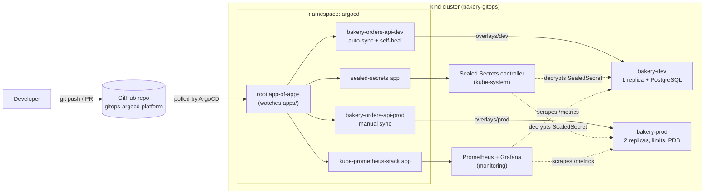

# gitops-argocd-platform

[](https://github.com/b0tjim/gitops-argocd-platform/actions/workflows/ci.yml)
[](bootstrap/argocd/kustomization.yaml)
[](LICENSE)

GitOps platform for the Dang Good Pies projects: an ArgoCD app-of-apps with
Kustomize dev/prod overlays and Sealed Secrets, deploying
[bakery-orders-api](https://github.com/b0tjim/bakery-orders-api) (via the Helm
chart in [k8s-observability-lab](https://github.com/b0tjim/k8s-observability-lab))
to a local kind cluster.

Built step by step; see [ROADMAP.md](ROADMAP.md) for the history.

## Architecture



## What it demonstrates

- **GitOps with ArgoCD**: the cluster state is whatever is on `main`; a
  root app-of-apps fans out to one `Application` per component.
- **Kustomize overlays** over a vendored Helm chart (`helmCharts` +
  `--enable-helm`), so dev and prod differ only in small, reviewable patches.
- **Safe secret handling**: only encrypted `SealedSecret`s are committed.
- **Promotion by pull request**: dev auto-syncs, prod needs a manual sync.
- **CI that proves it works**: lint, render, schema-validate, then a real
  kind + ArgoCD end-to-end sync on every push to `main`.

## Quick start

Needs Docker, [kind](https://kind.sigs.k8s.io/), kubectl and
[kubeseal](https://github.com/bitnami-labs/sealed-secrets#kubeseal).

```bash
make cluster-up       # 1. local cluster
make argocd-install   # 2. ArgoCD + the bakery AppProject
make root-app         # 3. ArgoCD installs everything else from apps/
```

Then re-seal the DB secret for your cluster (see [Secrets](#secrets)) and push
it. The apps sync from this repo's `main`, so to run your own copy, fork it and
point the `repoURL`s in `apps/` and `bootstrap/` at the fork. Watch the apps go green in the ArgoCD UI (see [ArgoCD](#argocd)).
The overlays pull `ghcr.io/b0tjim/bakery-orders-api:0.1.0`; if that image isn't
published yet, build it from the
[bakery-orders-api](https://github.com/b0tjim/bakery-orders-api) repo under
that tag and `kind load docker-image` it, as CI does.

## Layout

| Directory    | Role |
|--------------|------|
| `bootstrap/` | Applied by hand once: installs ArgoCD and the root app-of-apps. |
| `apps/`      | ArgoCD `Application` manifests; the root app watches this folder. |
| `platform/`  | Cluster add-ons (Sealed Secrets, kube-prometheus-stack). |
| `workloads/` | The bakery app: Kustomize base plus dev/prod overlays. |

## Local cluster

Needs [kind](https://kind.sigs.k8s.io/), Docker and kubectl.

```bash
make cluster-up     # single-node kind cluster named bakery-gitops
make cluster-down   # delete it
```

## ArgoCD

```bash
make argocd-install   # pinned ArgoCD v3.5.8 into the argocd namespace
make argocd-password  # initial admin password
kubectl -n argocd port-forward svc/argocd-server 8080:443
```

Then open <https://localhost:8080> (self-signed cert, so accept the browser
warning) and log in as `admin` with the printed password.

## Secrets

The database password is managed with
[Sealed Secrets](https://github.com/bitnami-labs/sealed-secrets). The controller
(installed by `apps/sealed-secrets.yaml`) holds a private key that never leaves
the cluster; anyone can encrypt with its public key, but only the controller can
decrypt. So the encrypted `SealedSecret` is safe to commit, and the plain Secret
never is (`.env` and `*.unsealed.yaml` are git-ignored).

Needs [kubeseal](https://github.com/bitnami-labs/sealed-secrets#kubeseal) and the
controller running in the cluster.

```bash
cp .env.example .env              # then set a real POSTGRES_PASSWORD
scripts/seal-db-secret.sh dev     # writes overlays/dev/postgresql-sealedsecret.yaml
scripts/seal-db-secret.sh prod    # same for prod
```

A SealedSecret is bound to its name and namespace, so each environment gets its
own. Re-run the script after rotating the password, or after recreating the
cluster (a new controller has a new key). To seal without cluster access, pass
the public cert: `SEALED_SECRETS_CERT=cert.pem scripts/seal-db-secret.sh dev`.

Each overlay lists its `postgresql-sealedsecret.yaml` as a resource and deletes
the chart's plain Secret, so the only Secret in the cluster is the one the
controller decrypts. The committed files hold the `.env.example` placeholders
sealed with a throwaway cert, so they only show the shape: on your cluster,
re-run the script for each environment before syncing.

## Promoting a release

Each overlay pins its image tag with Kustomize `images:`. A new version moves
dev → prod through two small PRs that bump `newTag`: dev auto-syncs, prod waits
for a manual sync. Full steps and rollback: [docs/promotion.md](docs/promotion.md).

## CI

Every push runs yamllint, `kustomize build --enable-helm` and kubeconform. On
`main`, an end-to-end job also creates a kind cluster, builds the app image from
source, installs ArgoCD, applies the root app and waits until
`bakery-orders-api-dev` is Synced and its Deployment is ready. The committed
SealedSecret can't be decrypted by that fresh controller (it was sealed with a
throwaway cert), so the job creates a CI-only plain DB Secret first; the
SealedSecret shows as Degraded there, which is expected.

## License

MIT
